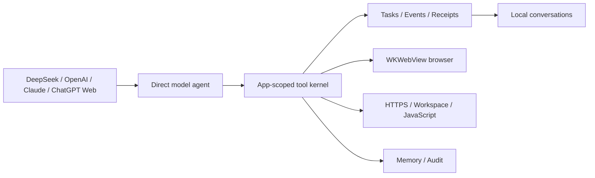

<div align="center">


# OPhone AI for iOS

**An open-source, app-scoped AI agent runtime for iPhone and iPad.**

[](https://github.com/SilverCoastR/OPhone-AI-IOS/actions/workflows/ios.yml)
[](project.yml)
[](OPhoneAI)
[](LICENSE)

**English** · [简体中文](README.zh-CN.md) · [한국어](README.ko-KR.md) · [日本語](README.ja-JP.md)

</div>

OPhone AI for iOS is a native SwiftUI rewrite of the portable parts of [OPhone AI for Android](https://github.com/SilverCoastR/OPhone-AI). It connects model APIs to durable tasks, structured events, a built-in browser, bounded HTTPS requests, private workspace files, reusable JavaScript utilities, user-visible memory, and an audit log.

## Features

- DeepSeek and OpenAI-compatible Chat Completions with SSE streaming and function calls.
- Claude through the native Anthropic Messages protocol, including `tool_use` and `tool_result` conversion.
- ChatGPT Web in a persistent `WKWebView` session.
- Device-local conversations that remain readable after changing API providers.
- API keys stored per provider in iOS Keychain.
- Durable tasks, checkpoints, cancellation, event feedback, execution receipts, and evidence-based completion.
- Built-in multi-tab browser with page inspection, DOM controls, JavaScript evaluation, screenshots, proper viewport sizing, and user zoom.
- Public-host HTTPS client with time and size bounds, an app-private file workspace, AI memory, audit records, and isolated JavaScript utilities.
- Optional remote provider catalog. The server supplies data; native protocol adapters remain versioned with the app.
- Anonymous app-open telemetry and update lookup through the project's Cloudflare endpoints.
- English, Simplified Chinese, Korean, and Japanese resources.

## iOS scope

iOS does not expose Android's cross-app Accessibility automation, root access, or a general-purpose shell to a normal application. At the owner's direction, the iOS project contains none of those features, switches, entitlements, or placeholder tool calls. OPhone AI automates only its own browser, network client, files, programs, memory, and task runtime.

The unsigned IPA produced by CI proves that the device target compiles, but iOS will not install it as a normal app. Use the signed workflow with an Apple Developer certificate and provisioning profile to produce an installable IPA. See [Build and signing](docs/BUILD_AND_SIGNING.md).

## Architecture



The model clients normalize provider responses to one local message shape. `ToolKernel` applies capability policy, task scope, idempotent call receipts, and audit logging before dispatch. Each mutating model call belongs to a durable task and carries a stable call ID.

Read [Architecture](docs/ARCHITECTURE.md), [Android-to-iOS port map](docs/PORTING.md), [Provider catalog format](docs/PROVIDER_CATALOG.md), and [Privacy](PRIVACY.md).

## Build

The repository uses [XcodeGen](https://github.com/yonaskolb/XcodeGen) so the project file is reproducible.

```bash
brew install xcodegen
xcodegen generate
xcodebuild -project OPhoneAI.xcodeproj -scheme OPhoneAI \
  -destination 'platform=iOS Simulator,name=iPhone 16 Pro' test
```

Every push to `main` runs tests on a GitHub-hosted Mac, archives the device app without code signing, packages `OPhone-AI-iOS-unsigned.ipa`, and uploads it as a workflow artifact.

## Security

- Provider keys use Keychain with `AfterFirstUnlockThisDeviceOnly` accessibility.
- Tool capabilities can be disabled independently.
- File operations cannot escape `Documents/OPhoneAIWorkspace`.
- The HTTP tool accepts HTTPS public hosts, limits request/response sizes, and excludes sensitive response headers.
- Remote provider data is validated and cannot add executable protocol adapters.
- Tool results, files, web pages, and memory are treated as untrusted input.

## License

Apache License 2.0.
